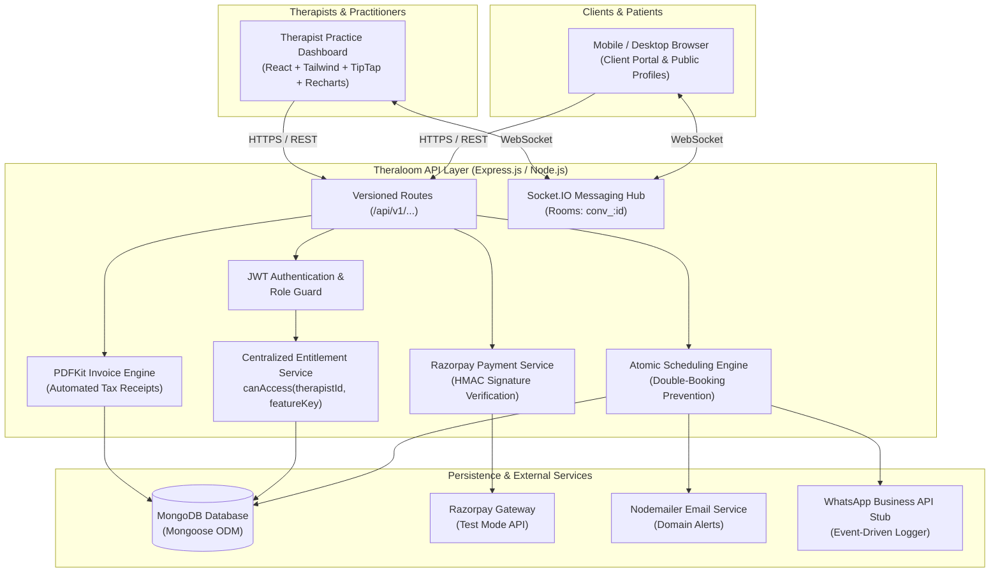
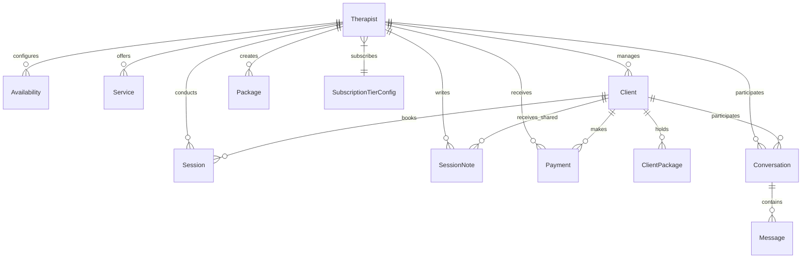

# THERALOOM — Full-Stack Telehealth & Practice Operating SaaS

> **Website Name:** Theraloom  
> **Tagline:** *Your practice, thoughtfully connected.*  
> **Domain Concept:** `theraloom.in`  
> **Target Audience:** Licensed clinical psychologists, psychotherapists, mental health counselors, and their clients across India.

---

## 1. Project Overview & Problem Statement

Independent therapists and mental health practitioners in India face an acute operational bottleneck. Practitioners routinely juggle fragmented tools: WhatsApp for inquiries, Google Calendar for schedules, manual UPI QR codes for payments, unencrypted Word documents for clinical notes, and physical receipts for accounting.

This fragmentation causes severe vulnerabilities:
1. **Clinical Privacy Risks:** Sensitive patient observations are stored in unencrypted, unorganized formats without role separation.
2. **Scheduling Friction & Double-Bookings:** Manual scheduling across timezones and client shifts frequently leads to scheduling conflicts and awkward cancellations.
3. **Billing Inefficiencies & Tax Compliance:** Manual tracking of multi-session bundles, cancellations, and GST tax invoice generation wastes clinical hours.
4. **Lack of Practice Business Intelligence:** Therapists have no automated visibility into patient no-show rates, monthly revenue trends, or caseload capacities.

**Theraloom** solves this comprehensively. It is a single, integrated, compliant SaaS operating system that provides therapists with a public branded booking page (e.g. `theraloom.in/dr-ananya-sharma`) and a practice hub covering calendar availability, client CRM, intake agreements, SOAP/DAP clinical notes, Razorpay payments, real-time Socket.IO chat, automated GST invoices, and aggregation-backed analytics.

---

## 2. Core Architectural Pillars

### A. Centralized Entitlement Service (`canAccess`)
Subscription tiers (**Starter**, **Growth**, **Unlimited**) are strictly configuration-driven and stored in the database (`SubscriptionTierConfig`). No route, controller, or UI component compares tier strings directly (e.g., `if (tier === 'starter')`). Instead, all feature restrictions funnel through one centralized function:
```javascript
const access = await entitlementService.canAccess(therapistId, 'advanced_note_templates');
if (!access.allowed) {
  return res.status(403).json({ code: 'TIER_LIMIT_REACHED', message: access.reason });
}
```
Changing tier quotas or permissions in MongoDB immediately updates system permissions across the entire platform without altering code.

### B. Role-Isolated Clinical Documentation (Private vs. Shared)
Every clinical note defaults strictly to `private`. Private notes are never returned by any client-facing endpoint or query. Even if a client inspects browser network payloads, the backend serializer guarantees that only notes explicitly marked as `shared` and sanitized of internal diagnostic hypotheses reach the client portal.

### C. Concurrency-Safe Atomic Double-Booking Prevention
Slot availability is enforced on the server using atomic MongoDB queries rather than relying on frontend calendar displays:
```javascript
const conflict = await Session.findOne({
  therapistId,
  status: { $in: ['scheduled', 'confirmed'] },
  $or: [
    { startTime: { $lt: end, $gte: start } },
    { endTime: { $gt: start, $lte: end } },
    { startTime: { $lte: start }, endTime: { $gte: end } },
  ],
});
if (conflict) {
  const error = new Error('Slot no longer available.');
  error.statusCode = 409;
  throw error;
}
```

### D. Server-Verified Payments & GST Tax Invoices
Theraloom integrates Razorpay in test mode. Payment authenticity is verified server-side using HMAC SHA-256 signatures. Invoices are generated as GST-compliant PDFs via PDFKit and automatically attached to the transaction record upon successful payment capture.

---

## 3. Technology Stack

| Layer | Technologies |
| :--- | :--- |
| **Frontend** | React 19, Vite, React Router v7, Tailwind CSS v4, Lucide React, Recharts, TipTap Rich Text Editor, Axios, Socket.IO Client, date-fns |
| **Backend API** | Node.js, Express.js (REST v1), express-validator, bcryptjs, jsonwebtoken (JWT), Multer, PDFKit, Nodemailer |
| **Real-Time Communication** | Socket.IO (WebSockets with polling fallback) for authenticated therapist-client messaging rooms |
| **Database & ODM** | MongoDB, Mongoose ODM with aggregation pipelines, MongoDB Memory Server for zero-friction local/offline execution |
| **Payment Gateway** | Razorpay (Test mode with webhook verification and HMAC-SHA256 signature validation) |
| **Video Telehealth** | Jitsi Meet room generation with end-to-end encrypted room slugs |

---

## 4. System Architecture Diagram



---

## 5. Project Folder Structure

```
theraloom/
├── theraloom-backend/
│   ├── src/
│   │   ├── config/
│   │   │   ├── db.js                 # Resilient MongoDB / MongoMemoryServer connection
│   │   │   └── razorpay.js           # Razorpay client initialization
│   │   ├── controllers/
│   │   │   ├── analyticsController.js # Aggregation-backed practice metrics
│   │   │   ├── authController.js      # JWT registration, login, logout, me
│   │   │   ├── chatController.js      # Messaging threads and notifications
│   │   │   ├── clientController.js    # CRM and portal lookup
│   │   │   ├── noteController.js      # Role-isolated clinical note operations
│   │   │   ├── paymentController.js   # Razorpay orders, verification, packages
│   │   │   ├── schedulingController.js# Slot generation and session booking
│   │   │   ├── therapistController.js # Public profile and practice settings
│   │   │   └── tierController.js      # Entitlement tier queries and upgrades
│   │   ├── middleware/
│   │   │   ├── authMiddleware.js      # Therapist JWT bearer guard
│   │   │   ├── entitlementMiddleware.js # Route-level feature gate middleware
│   │   │   ├── errorHandler.js       # Centralized error formatter
│   │   │   └── uploadMiddleware.js   # Multer file handler for avatars
│   │   ├── models/
│   │   │   ├── Availability.js        # Weekly schedule and blocked dates
│   │   │   ├── Client.js              # Patient CRM, demographics & MHCA consent
│   │   │   ├── ClientPackage.js       # Remaining session trackers
│   │   │   ├── Conversation.js        # Messaging channels
│   │   │   ├── Message.js             # Chat messages with read receipts
│   │   │   ├── Notification.js        # Practice alerts
│   │   │   ├── Package.js             # 3, 6, 12 multi-session definitions
│   │   │   ├── Payment.js             # Financial transactions & invoice refs
│   │   │   ├── Session.js             # Bookings with meeting links & statuses
│   │   │   ├── SessionNote.js         # Private/Shared clinical notes (SOAP/DAP)
│   │   │   ├── SubscriptionTierConfig.js # Dynamic tier flags and caps
│   │   │   └── Therapist.js           # Practitioner credentials, slug, and fee
│   │   ├── routes/                    # Versioned Express routes (/api/v1/...)
│   │   ├── services/
│   │   │   ├── analyticsService.js    # Real-time MongoDB aggregation pipelines
│   │   │   ├── entitlementService.js  # Single source of truth for tier access
│   │   │   ├── invoiceService.js      # PDFKit GST tax invoice generator
│   │   │   ├── notificationService.js # Nodemailer + WhatsApp stub events
│   │   │   ├── paymentService.js      # Razorpay order and HMAC verification
│   │   │   └── schedulingService.js   # Atomic concurrency booking logic
│   │   ├── sockets/
│   │   │   └── chatSocket.js          # Socket.IO room lifecycle & typing events
│   │   ├── utils/
│   │   │   ├── generateSlug.js        # URL-safe collision-handled slug generator
│   │   │   └── seed.js                # Realistic Indian clinical practice seed data
│   │   ├── app.js                     # Express app configuration & middleware
│   │   └── server.js                  # HTTP + Socket.IO server entry point
│   ├── tests/
│   │   └── runTests.js                # Complete automated end-to-end test suite
│   ├── .env.example
│   └── package.json
│
└── theraloom-frontend/
    ├── public/
    │   ├── images/                    # Brand SVG logos and service illustrations
    │   └── favicon.svg                # Brand icon
    ├── src/
    │   ├── api/
    │   │   └── axiosInstance.js       # Axios base instance with JWT interceptors
    │   ├── components/
    │   │   ├── chat/ChatWindow.jsx    # Real-time Socket.IO chat UI
    │   │   ├── common/Navbar.jsx      # Adaptive brand navigation
    │   │   ├── common/Footer.jsx      # Indian MHCA awareness & crisis helplines
    │   │   ├── common/Avatar.jsx      # Initials fallback avatar
    │   │   ├── common/UpgradeModal.jsx# Entitlement gate upgrade prompt
    │   │   ├── notes/NoteEditor.jsx   # TipTap rich-text + SOAP/DAP templates
    │   │   └── scheduling/BookingModal.jsx # Multi-step booking & payment modal
    │   ├── context/
    │   │   └── AuthContext.jsx        # Practitioner authentication state
    │   ├── hooks/
    │   │   └── useEntitlement.js      # Client-side tier access hook
    │   ├── pages/
    │   │   ├── auth/Login.jsx         # Login with one-click demo accounts
    │   │   ├── auth/Register.jsx      # Signup with live slug preview
    │   │   ├── client/ClientPortal.jsx# Patient sanctuary (notes, video, chat)
    │   │   ├── public/Home.jsx        # Homepage with hero, directory & tiers
    │   │   ├── public/TherapistProfile.jsx # Public branded profile (/:slug)
    │   │   └── therapist/             # Protected practitioner workspace
    │   │       ├── Dashboard.jsx      # Practice overview and key metrics
    │   │       ├── Clients.jsx        # Patient CRM & intake records
    │   │       ├── Schedule.jsx       # Availability & calendar management
    │   │       ├── Notes.jsx          # Clinical documentation hub
    │   │       ├── Payments.jsx       # Razorpay transactions & packages
    │   │       ├── Chat.jsx           # Real-time practitioner messaging
    │   │       ├── Analytics.jsx      # Recharts revenue & no-show trends
    │   │       ├── Subscription.jsx   # Dynamic tier upgrade management
    │   │       └── Settings.jsx       # Practice info & service editor
    │   ├── routes/
    │   │   ├── AppRoutes.jsx          # Route declarations
    │   │   └── ProtectedRoute.jsx     # Route authentication guard
    │   ├── App.jsx
    │   ├── index.css                  # Tailored brand color variables
    │   └── main.jsx
    ├── .env.example
    └── package.json
```

---

## 6. Database Models & Schema Relationships



### Key Models Summary
- **Therapist:** Stores clinical profile, email, bcrypt password hash, unique URL slug, title, qualifications, languages, consultation fee, and active subscription reference.
- **Client:** CRM record with tags, demographic fields, presenting concerns, and timestamped auditable digital consent records under MHCA 2017.
- **Session:** Booked appointment with startTime, endTime, date, duration, pricing, Jitsi Meet URL, and statuses (`scheduled`, `confirmed`, `completed`, `cancelled`, `no_show`).
- **SessionNote:** Clinical notes with `noteType: 'private' | 'shared'`, `format: 'freeform' | 'SOAP' | 'DAP'`, and rich-text HTML.
- **Availability:** Weekly schedule template (days of week, window start/end), buffer times (10/15/20 mins), and blocked dates.
- **Payment:** Records `amount`, `netAmount`, `platformFee`, Razorpay Order ID, Payment ID, Signature, and auto-generated PDF invoice URL.
- **SubscriptionTierConfig:** Configuration-driven tier definitions (`tierKey`, `maxActiveClients`, `advancedNoteTemplates`, `analyticsDepth`, `monthlyPrice`).

---

## 7. Setup & Installation Guide

### Prerequisites
- **Node.js:** v18+ (tested on v24.x)
- **npm:** v9+
- **MongoDB:** Local MongoDB daemon OR MongoDB Atlas connection string (an automatic in-memory fallback is also included).

### Step 1: Clone and Setup Backend
```bash
# Navigate to backend
cd theraloom/theraloom-backend

# Install dependencies
npm install

# Configure environment variables
cp .env.example .env
```

Verify backend `.env` values:
```ini
PORT=5000
NODE_ENV=development
MONGO_URI=mongodb://127.0.0.1:27017/theraloom
JWT_SECRET=theraloom_super_secure_jwt_secret_key_2026_india
JWT_EXPIRES_IN=7d
FRONTEND_URL=http://localhost:5173
RAZORPAY_KEY_ID=rzp_test_theraloom_key123
RAZORPAY_KEY_SECRET=rzp_test_secret_theraloom456
RAZORPAY_WEBHOOK_SECRET=rzp_webhook_secret_theraloom789
EMAIL_HOST=smtp.ethereal.email
EMAIL_PORT=587
EMAIL_USER=demo@ethereal.email
EMAIL_PASS=demopassword
EMAIL_FROM="Theraloom Practice" <notifications@theraloom.in>
```

### Step 2: Seed the Database
Populate realistic demo therapists, patients, calendar availability, SOAP/DAP notes, and Razorpay transactions:
```bash
npm run seed
```

*Pre-seeded Demo Accounts:*
- **Dr. Ananya Sharma** (Growth Tier): `ananya.sharma@theraloom.in` | `Password@123` | Public link: `http://localhost:5173/dr-ananya-sharma`
- **Priya Nair** (Starter Tier): `priya.nair@theraloom.in` | `Password@123` | Public link: `http://localhost:5173/priya-nair`
- **Dr. Rajesh Menon** (Unlimited Tier): `rajesh.menon@theraloom.in` | `Password@123` | Public link: `http://localhost:5173/dr-rajesh-menon`

### Step 3: Run the Backend Automated Test Suite
```bash
npm test
```
*Expected Result:* **11 Passed, 0 Failed** across all modules.

### Step 4: Setup and Run the Frontend Client
In a new terminal window:
```bash
# Navigate to frontend
cd theraloom/theraloom-frontend

# Install dependencies
npm install

# Start Vite development server
npm run dev
```

The frontend will run at: **`http://localhost:5173`**  
The backend will run at: **`http://localhost:5000`**

---

## 8. API Documentation (`/api/v1`)

| Endpoint | Method | Access | Description |
| :--- | :---: | :---: | :--- |
| `/api/v1/health` | `GET` | Public | System health check and uptime monitor |
| `/api/v1/auth/register` | `POST` | Public | Register new therapist with auto-generated unique slug |
| `/api/v1/auth/login` | `POST` | Public | Therapist authentication and JWT token issue |
| `/api/v1/auth/me` | `GET` | Protected | Fetch authenticated therapist profile and subscription |
| `/api/v1/therapists/directory` | `GET` | Public | Discover active verified therapists across India |
| `/api/v1/therapists/public/:slug` | `GET` | Public | Branded profile data with services, fee, and credentials |
| `/api/v1/therapists/profile` | `PUT` | Protected | Update bio, qualifications, fee, services, and slug |
| `/api/v1/scheduling/available-slots`| `GET` | Public | Compute non-overlapping open slots for date & timezone |
| `/api/v1/scheduling/book-session` | `POST` | Public | Concurrency-safe atomic booking creation |
| `/api/v1/scheduling/sessions` | `GET` | Protected | Practitioner calendar agenda and session history |
| `/api/v1/scheduling/sessions/:id/status`| `PUT` | Protected | Mark completed, cancelled, or no-show |
| `/api/v1/clients` | `GET` | Protected | Caseload CRM with search, filters, and intake records |
| `/api/v1/clients/portal-lookup` | `GET` | Public | Client portal access via verified booking email |
| `/api/v1/notes` | `GET` | Protected | Therapist clinical note repository (Private + Shared) |
| `/api/v1/notes` | `POST` | Protected | Create new SOAP, DAP, or freeform note (gated by tier) |
| `/api/v1/notes/shared/:clientId` | `GET` | Client | Strictly returns notes marked `shared` (Zero leak) |
| `/api/v1/payments/create-order` | `POST` | Public | Initialize Razorpay order with minor units (paise) |
| `/api/v1/payments/verify` | `POST` | Public | Verify payment signature and generate GST PDF receipt |
| `/api/v1/payments/packages` | `POST` | Protected | Define 3, 6, 12 session bundles |
| `/api/v1/chat/conversations` | `GET` | Protected | Practitioner messaging threads and unread counters |
| `/api/v1/analytics/dashboard` | `GET` | Protected | MongoDB aggregation metrics: revenue, no-show rate |
| `/api/v1/tiers` | `GET` | Public | Dynamic subscription tier flags and quotas |
| `/api/v1/tiers/upgrade` | `POST` | Protected | Upgrade practice tier via centralized entitlement engine |

---

## 9. Security, Privacy & Indian Healthcare Compliance

1. **Mental Healthcare Act (MHCA 2017) Digital Consent:** Clients are required to acknowledge telehealth consent, confidentiality clauses, and emergency protocol limitations before confirming an appointment. Each consent event is stored with a timestamp and IP address as an auditable record.
2. **Indian Crisis Protocol Notice:** The website and client portal prominently display Government of India tele-mental health helplines:
   - **Tele-MANAS:** `14416`
   - **Vandrevala Foundation:** `+91 9999 666 555`
   - **KIRAN Helpline:** `1800-599-0019`
3. **No Hardcoded Secrets:** Credentials, webhook secrets, and private keys reside strictly in backend `.env` variables and are never committed or bundled into the React frontend.
4. **Data Isolation:** Private clinical notes cannot be queried or returned through public or client-facing endpoints.
5. **NoSQL & Injection Hardening:** Request payloads are validated via `express-validator` and sanitized.

---

## 10. Automated Testing Verification

The backend test suite (`tests/runTests.js`) tests all core requirements:

```
======================================================
🧪 Starting Theraloom End-to-End Automated Test Suite
======================================================

📦 Module 1: Authentication, Profiles & Unique Slugs
  ✓ Therapist password hashing & verification works
  ✓ Slug generation creates URL-safe slug and handles duplicate collisions

📦 Module 2: Scheduling & Atomic Double-Booking Prevention
  ✓ First booking succeeds and creates session record
  ✓ Conflicting overlapping booking is atomically rejected with 409 Conflict

📦 Module 3: Client CRM, Intake & Versioned Digital Consent
  ✓ Client intake demographic & presenting concerns are recorded
  ✓ Digital consent record is timestamped and auditable

📦 Module 4: Payments, Verification & GST Invoices
  ✓ Payment signature verification and invoice PDF generation work

📦 Module 5: Clinical Documentation & Private Note Protection
  ✓ Private clinical note is created and isolated from shared queries

📦 Module 7: Subscription Entitlements & Centralized Feature Gating
  ✓ Entitlement service gates active clients according to tier limit
  ✓ Entitlement service gates SOAP/DAP templates to Growth/Unlimited plans
  ✓ Upgrading tier unlocks gated features dynamically through canAccess

======================================================
📊 Test Results: 11 Passed, 0 Failed
======================================================
```

---

## 11. Production Deployment Guide

### Frontend Deployment (e.g. Vercel)
1. Push the repository to GitHub.
2. In Vercel, set root directory to `theraloom-frontend`.
3. Add environment variables:
   - `VITE_API_BASE_URL=https://your-backend-api.onrender.com/api/v1`
   - `VITE_RAZORPAY_KEY_ID=rzp_test_theraloom_key123`
4. Deploy.

### Backend Deployment (e.g. Render / Railway)
1. Set root directory to `theraloom-backend`.
2. Build command: `npm install`
3. Start command: `node server.js`
4. Configure production environment variables (`MONGO_URI`, `JWT_SECRET`, `FRONTEND_URL`, `RAZORPAY_KEY_ID`, `RAZORPAY_KEY_SECRET`).

---

## 12. Asset & Image Credits
- **Brand Geometry & Logos:** Custom vector SVG assets located in `public/images/logo.svg` and `public/images/logo-icon.svg`.
- **Therapy Consultation Environment Photography:** Licensed via Unsplash (Photo by Dan Gold / Unsplash).
- **Service Graphics:** Original calming vector illustrations in `public/images/service-*.svg`.
- **Icons:** Lucide React icon library.

---

## 13. License
Theraloom is developed as a complete full-stack major software engineering project under the MIT License.
